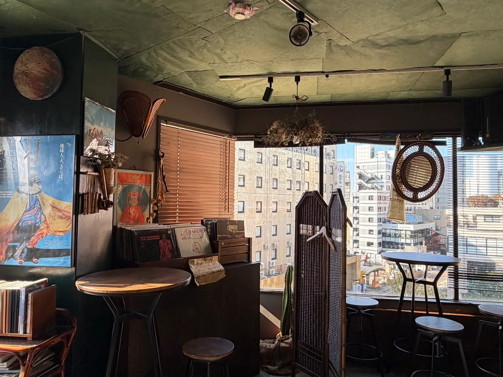
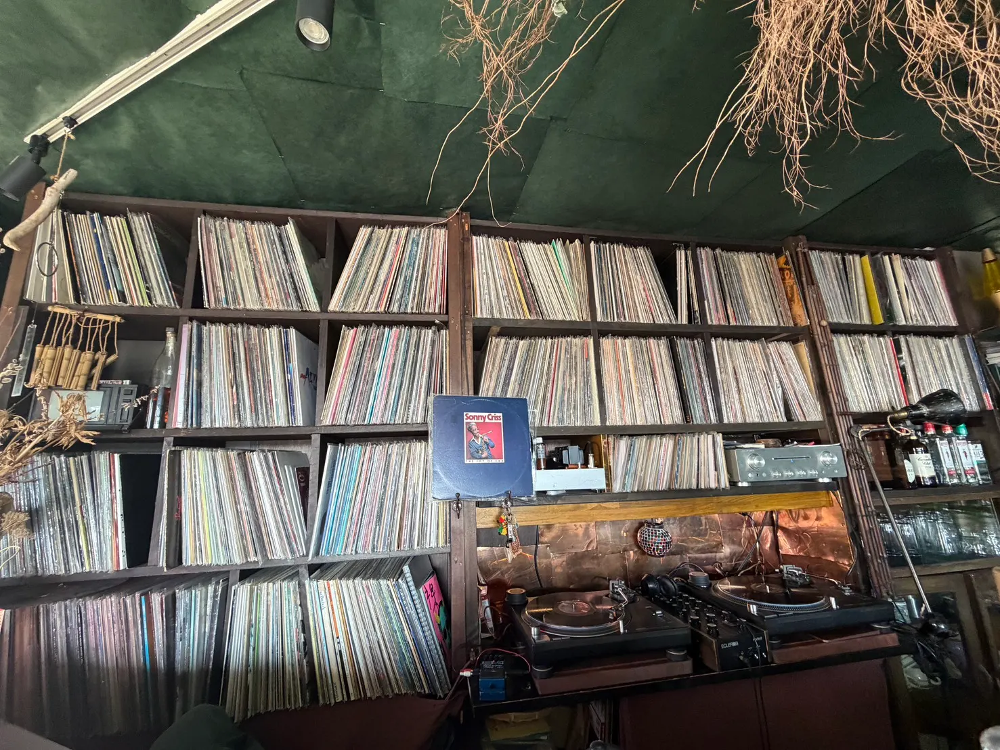
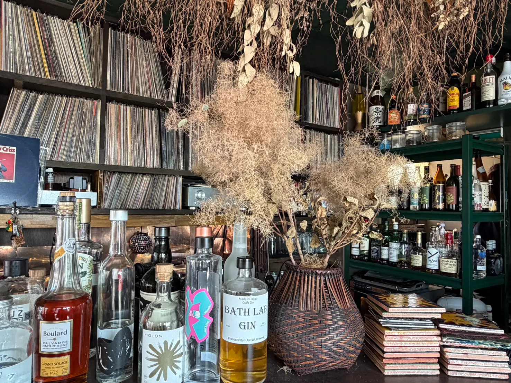

Kanazawa has plenty of famous cafés, the kind with a line out the door and a matcha parfait on every table. This list is not about those. These are small, independent places where locals actually sit down, and where you can order without pointing and hoping for the best.

【ZUMA: 2軒目・3軒目が決まったら、ここに3軒の共通点を1〜2文で】

## 1. Kissa Bongo: a record café on the fifth floor

You would walk right past Kissa Bongo if nobody told you about it. It is on the fifth floor of an ordinary building in Kakinokibatake, a few minutes from Korinbo, and you have to know to go up.

I went on a clear afternoon, and the room was full of sunlight. Tall windows run along it, and you look straight out over the buildings of central Kanazawa.

The room itself is like nowhere else I know in the city. The ceiling is covered in dark green paper, dried flowers hang over the counter, and there are wicker armchairs and a wicker sofa by the windows. Along one wall is a long counter with high stools, and behind it, shelf after shelf of vinyl records, with two turntables and a mixer set up in the middle.

During the day it is a *kissa*, a Japanese-style café. In the evening the same room turns into a music bar, which explains the shelves of gin and whisky bottles behind the counter.

I ordered a hot sandwich and an iced coffee. The hot sandwich was ¥900, and the two together came to ¥1,420. The sandwich was really good, with a soft-boiled egg inside. The iced coffee was smooth, easy to drink and tasty too.

### Can you get by in English?

Easily. The owner is American, grew up in Japan, and speaks both English and Japanese, so you can just ask about the menu or the records in English. I think the menu had English on it as well, though I didn't look closely, and with the owner right there it hardly matters.

If you want to try a little Japanese anyway, this one works anywhere:

> **Kore o kudasai.** (koh-reh oh koo-dah-sigh) — "This one, please."

### Local tip

- **Look up.** The café is on the fifth floor, so look for the building, not a shop front at street level.
- **Day and night are different.** The café hours and the bar hours are not the same. Bongo is closed on Mondays, and it is worth checking the café's Instagram before you go.

## 2. SHIKA

【ZUMA: SHIKAの取材後に追加】

## 3. 【リスパイス：英語表記は取材後に確認】

【ZUMA: リスパイスの取材後に追加（英語が通じるかも確認）】
